# 03 — Modelo de dados

O schema está em `apps/api/src/persistence/schema.ts`, e as migrações versionadas ficam em `apps/api/drizzle/` (geradas com `npm run db:generate`).

## Convenções

- Toda tabela com dados de usuário tem `user_id`, o que dá autorização uniforme e consultas simples.
- Exclusão em cascata só parte de `users` (quando a própria conta é excluída). Entre entidades, as FKs usam **NO ACTION** ou **SET NULL**: apagar uma definição que tem histórico falha com 409, e a interface sugere arquivar.
- O livro-razão é imutável: `reward_grants` (+ `grant_attribute_xp`, `grant_skill_xp`), `coin_transactions` (com `seq` estrita) e `penalty_applications`.
- As projeções (`character_progress`, `wallets`, `attributes.xp/level`, `skills.xp/level`, `habits.current_streak/best_streak`) são verificáveis e reconstruíveis pelo Admin.
- `DATE` guarda datas locais do usuário; `TIMESTAMPTZ` guarda instantes.
- Uso de JSONB, com justificativa: configuração versionada do jogo (snapshot), critérios de conquista (DSL validada), pesos de atributos (mapa pequeno com códigos imutáveis), explicações de recompensa (auditoria), preferências de interface e *snapshots* de regra ou de item.
- Restrições: `wallet_balance_nonneg`, `coin_tx_balance_nonneg`, `character_xp_nonneg` e unicidades de idempotência (`reward_grants(user_id, idempotency_key)`, `purchases(user_id, idempotency_key)`, `penalty_applications(...)`, `habit_checkins(habit_id, local_date)`, `missions(template_id, period_key)`, `activities(user_id, source, external_id)`).

## Diagrama de entidades (principais)

```mermaid
erDiagram
  users ||--|| user_settings : tem
  users ||--|| character_progress : projeta
  users ||--|| wallets : projeta
  users ||--o{ game_configs : versiona
  users ||--o{ attributes : possui
  attributes ||--o{ skills : agrupa
  skills ||--o{ skills : "árvore (parent)"
  users ||--o{ categories : define

  users ||--o{ reward_grants : "livro-razão"
  reward_grants ||--o{ grant_attribute_xp : linhas
  reward_grants ||--o{ grant_skill_xp : linhas
  reward_grants ||--o| coin_transactions : moedas
  reward_grants ||--o| reward_grants : "estorno de"
  coin_transactions }o--o| purchases : "gasto/reembolso"
  coin_transactions }o--o| penalty_applications : penalidade

  users ||--o{ missions : cria
  mission_templates ||--o{ missions : "gera (período)"
  missions ||--o{ mission_objectives : objetivos
  missions ||--o{ mission_events : "histórico"
  missions }o--o{ penalty_rules : "mission_penalty_rules"
  goals ||--o{ missions : vincula
  goals ||--o{ goal_milestones : etapas
  goals }o--o{ goals : "goal_dependencies"

  users ||--o{ habits : define
  habits ||--o{ habit_checkins : registros
  habits }o--o{ penalty_rules : "habit_penalty_rules"
  penalty_rules ||--o{ penalty_applications : aplica
  users ||--o{ unavailability : registra

  knowledge_areas ||--o{ study_subjects : agrupa
  study_subjects }o--o{ study_subjects : "pré-requisitos"
  study_subjects ||--o{ study_resources : recursos
  study_subjects ||--o{ study_sessions : sessões
  study_subjects ||--o{ assessments : avaliações
  study_subjects ||--o{ subject_milestones : "domínio"
  study_subjects }o--o| skills : maestria

  activity_types ||--o{ activities : tipo
  activities ||--o{ activity_sets : séries
  exercises ||--o{ activity_sets : exercício
  activities ||--o{ personal_records : recordes

  items ||--o{ purchases : comprado
  items ||--o{ inventory_items : instância
  achievements ||--o{ user_achievements : desbloqueio
  seasons ||--o{ season_rewards : recompensas
  users ||--o{ integration_connections : conecta
  users ||--o{ integration_events : recebe
  users ||--o{ audit_log : audita
```

As tabelas restantes são `sessions`, `ranks`, `level_rewards`, `level_history`, `quick_logs`, `notifications` e `page_visits`.

## Revisão da lista sugerida

| Sugestão original | Decisão |
|---|---|
| AttributeDefinition + UserAttribute | Unificadas em `attributes`: as definições já são por usuário e editáveis. XP e nível são projeções. |
| TitleDefinition / UserTitle | Unificados em `items` (kind `title`) + `inventory_items`. Títulos vêm da loja, de conquistas, de marcos de nível e de temporadas. |
| XPEvent / XPBalance | `reward_grants` (cabeçalho com idempotência e explicação) + linhas de atributo/habilidade + projeção `character_progress`. |
| HabitSchedule | Campos no próprio hábito (`frequency`, `weekdays_mask`, `times_per_week`). |
| ExternalActivity | `activities` com `source` + `external_id` (único) e `integration_events` para os eventos recebidos. |
| SeasonProgress | Derivado do livro-razão no período (`seasonStats`) e gravado como `summary` no encerramento. |
